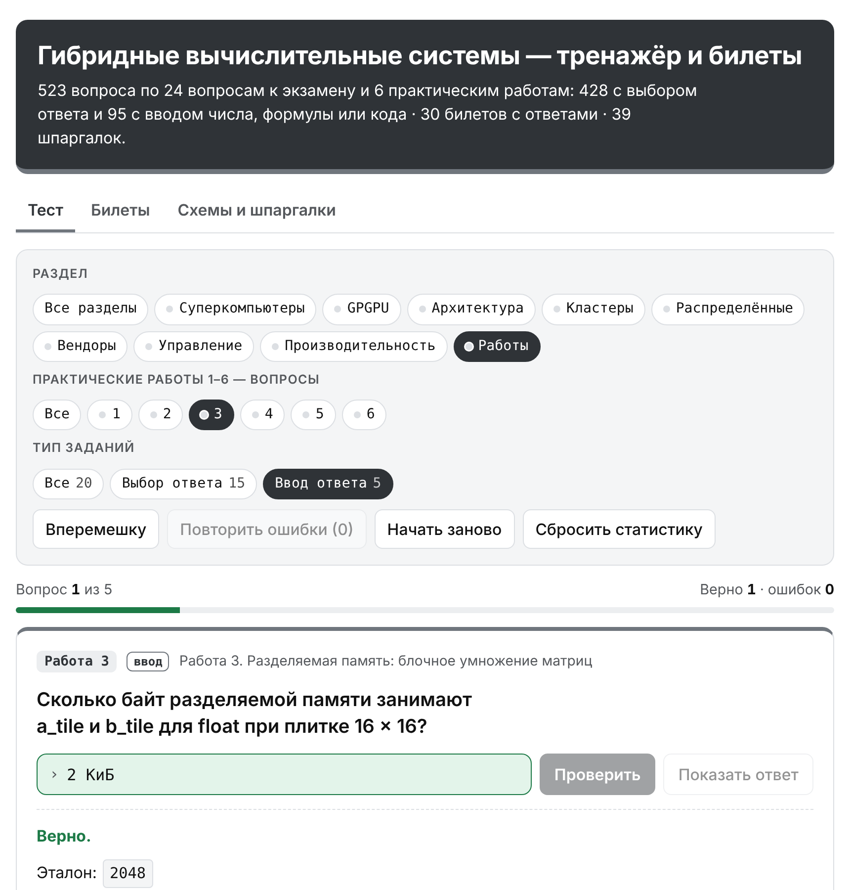

# ГВС: тренажёр и билеты

Тренажёр к экзамену и защите практик по «Гибридным вычислительным системам» (ст. преп. С. А. Тарасов, СФУ, ИКИТ, каф. ВпВ). Около 520 вопросов по 24 вопросам к экзамену («Гибридные кластерные системы») и 6 практическим работам. Часть с вводом ответа: размер сетки, байты shared-памяти, ускорение по замерам, фрагмент кода CUDA, команда Torque. Ещё есть 30 билетов с ответами, шпаргалки и схемы.

Сайт: https://ktoblyachtoblyayablya.github.io/hsys-trainer/



## Что внутри

- Тест по разделам: суперкомпьютеры, GPGPU, архитектура GPU и CUDA, кластеры, распределённые вычисления, вендоры, управление кластером, производительность, работы 1–6. После ответа показываются пояснение, схема и шпаргалка.
- Задания с вводом. В коде CUDA и командах регистр важен. Число можно писать с запятой, дробью (`1/16`), как `2^20` или с единицами (`320 ГБ/с`), допуск 0,5 %.
- Билеты: ответ на каждый вопрос к экзамену, а по практикам — что сделано в коде, результаты замеров и что спросят на защите. Графики работ 1–2 построены по замерам Google Benchmark.
- Все билеты одной страницей (`#all`) и версия для печати (`#print`).
- Повтор ошибок, светлая и тёмная тема. Прогресс хранится в браузере, сервер не нужен.

Практические работы: 1 — Data + View, сложение векторов; 2 — наивное умножение матриц; 3 — умножение с тайлами в shared memory; 4 — умножение на тензорных ядрах (WMMA); 5 — редукция вектора; 6 — conv2d как расширение PyTorch. Задания: [jzcurious/hsys-tasks](https://github.com/jzcurious/hsys-tasks).

## Запуск

Открыть `index.html` в браузере или поднять сервер: `python3 -m http.server 8000`.

## Как добавить вопрос

Вопросы лежат в `data/questions/*.js`, билеты — в `data/answers/*.js`, шпаргалки — в `data/cards.js`. Пример задания с вводом:

```js
{t:"lab-1", q:"Сколько блоков по 256 нитей запустится для n = 1029?",
 a:["5"],
 h:"число блоков",
 e:"(1029 + 255) / 256 = 5 — 1280 нитей, 251 лишняя."}
```

`t` — тема (номер вопроса к экзамену или работа), `q` — вопрос, `a` — принимаемые ответы (первый показывается как эталон), `e` — пояснение. В вопросах с выбором вместо `a` пишется `o` — варианты, первый правильный. Необязательные поля: `pr` — текст перед полем ввода, `h` — подсказка, `ci: 1` — без учёта регистра, `f` — картинка, `fb: 1` — показать картинку сразу, `c` — шпаргалка.

После правок запустите `node tools/validate.js` (нужен Node.js 18+). Та же проверка идёт в GitHub Actions при каждом пуше.

## Что может устареть

Данные Top500 взяты по 67-му списку (июнь 2026). Если в новом списке сменится лидер, обновите билет `hpc-3`, шпаргалку `top10`, вопросы `hpc-3` и график `sv_top10` (данные в `tools/draw_src/draw.py`).

## Литература курса

1. Боресков А. В., Харламов А. А. Основы работы с технологией CUDA. — М.: ДМК Пресс, 2010. — 232 с.
2. Линев А. В., Боголепов Д. К., Бастраков С. И., Гергель В. П. Технологии параллельного программирования для процессоров новых архитектур. — М.: Изд-во МГУ, 2010.
3. Боресков А. В., Харламов А. А., Марковский Н. Д. и др. Параллельные вычисления на GPU. Архитектура и программная модель CUDA. — М.: Изд-во МГУ, 2012. — 336 с.
4. Гергель В. П. Современные языки и технологии параллельного программирования. — М.: Изд-во МГУ, 2012.
5. Сандерс Дж., Кэндрот Э. Технология CUDA в примерах: введение в программирование графических процессоров. — М.: ДМК Пресс, 2011. — 232 с.
6. Бастраков С. И. Введение в CUDA. Язык CUDA C: лекция. — Н. Новгород: ННГУ, 2012. — 36 с.
7. Моисеенков М. С. Работа с системой обработки заданий Torque. — ПГНИУ, НОЦ «Параллельные и распределённые вычисления».
8. Бенинкоса В. Ganglia и Nagios. Часть 1. Мониторинг коммерческих кластеров с помощью Ganglia. — IBM developerWorks, 2009.
9. Кондаков К. Ganglia. Система мониторинга для кластеров // Системный администратор. — 2011. — С. 44–49.

## Лицензия

Copyright (C) 2026 Пантелеев Г.Д. Код, вопросы, билеты и схемы распространяются под [GPL-3.0-or-later](LICENSE).
